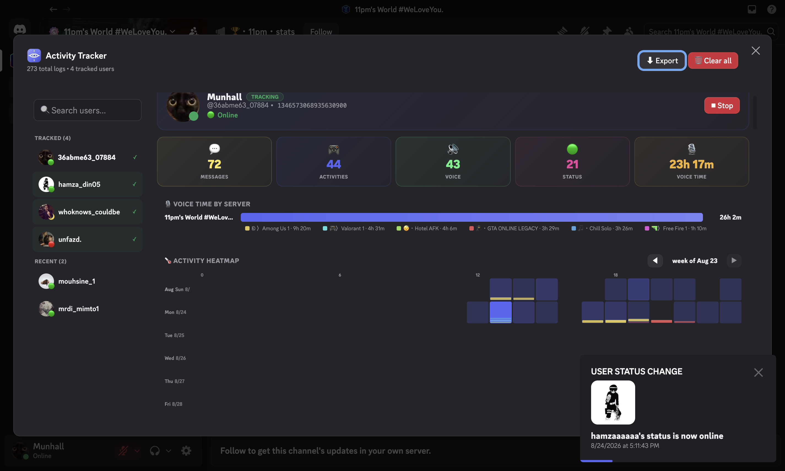
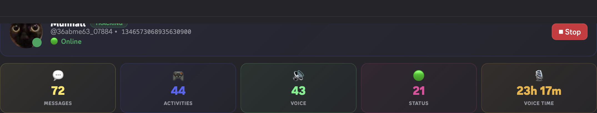
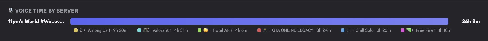
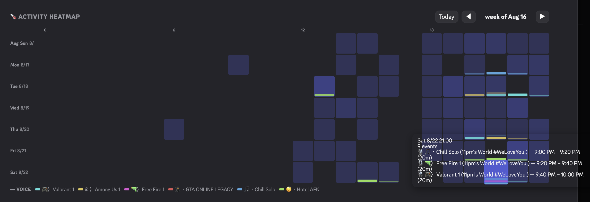
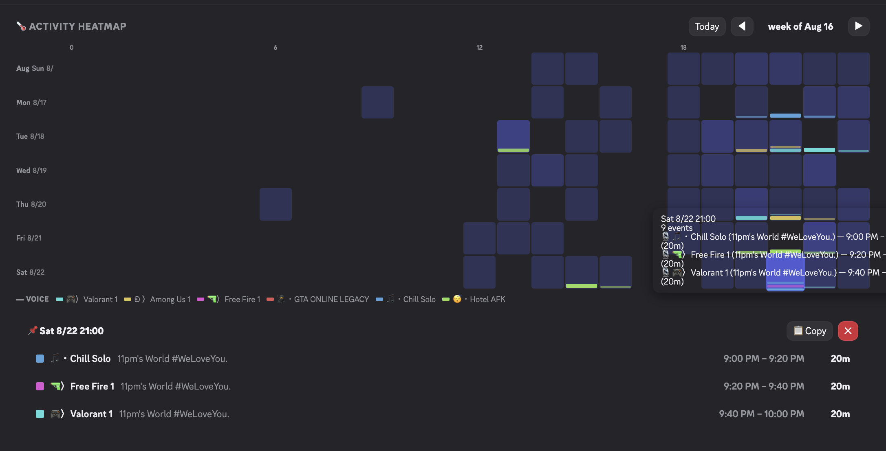
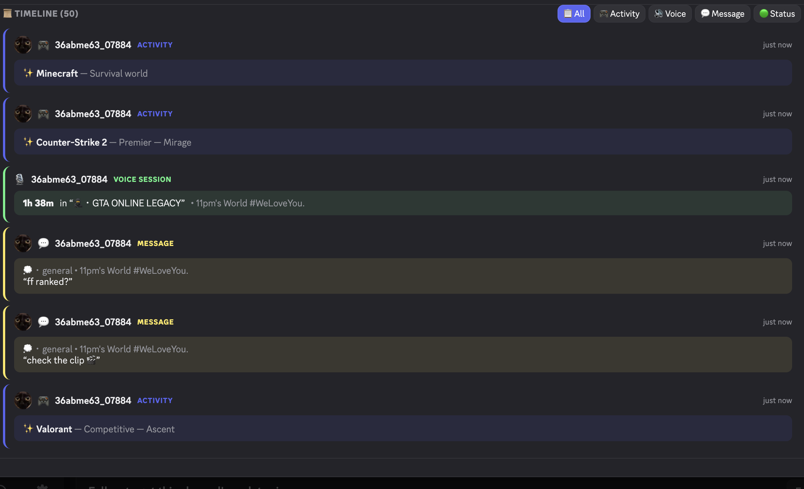

# Discord Activity Tracker — Vencord Plugin

**A Vencord plugin that shows voice time per server, an hour-by-hour activity heatmap, and a full timeline for the Discord users you choose to track. Everything stays on your machine.**

[](LICENSE)
[](https://docs.vencord.dev/installing/custom-plugins/)
[](https://github.com/elioflex/Discord-Activity-Tracker/stargazers)



**Quick install** (requires [Vencord built from source](https://docs.vencord.dev/installing/)):

```bash
git clone https://github.com/elioflex/Discord-Activity-Tracker Vencord/src/userplugins/ActivityTracker
```

Then rebuild Vencord and enable **ActivityTracker**. Full steps are under [Installation](#installation).

## Features

- **Voice session tracking** — join/leave/move events are paired into single sessions with duration, server, and channel (ongoing sessions show a LIVE badge)
- **Activity tracking** — gaming, Spotify, streaming, and custom activities
- **Message logging** — messages from tracked users with channel and server
- **Status changes** — online / offline / idle / dnd updates
- **Interactive dashboard**:
  - Per-user profile with live presence (avatar, status, current activity, track/stop toggle)
  - Stat strip — messages / activities / voice / status counts plus total voice time
  - **Voice time by server** — ranked bars with per-channel chips and durations
  - **Activity heatmap** — week-by-week grid with voice sessions drawn as thin proportional lines; hover any hour for the exact channels and time windows, click to pin a copyable breakdown, ◀/▶ to walk through weeks
  - **Timeline** — every event, with voice sessions merged into single entries (duration + LIVE badge)
  - Filter by activity type, search by username/ID, export JSON/TXT/CSV, clear all

## Preview

Screenshots captured against a real development server, showing actual members and channels:

### Dashboard overview

The full dashboard (shown at the top): sidebar with member avatars and presence dots, plus the selected user's profile card.

### Profile & stats


Profile card — real avatar, TRACKING badge, live status with current activity — above the stat strip.

### Voice time by server


Total voice time grouped by server, with a channel chip and duration for every voice channel the user joined.

### Heatmap hover


Hovering an hour cell reveals every voice session in that hour — channel, server, exact time window, and duration.

### Heatmap pinned breakdown


Clicking an hour pins a breakdown of every channel window in that hour, with a one-click copy button.

### Activity timeline


The chronological timeline with paired voice sessions — single entries with durations and a LIVE badge on the ongoing session.

## Installation

This is a Vencord **userplugin**, so it isn't in the official plugin list. You need a [source build of Vencord](https://docs.vencord.dev/installing/) and [git](https://git-scm.com/), [Node.js](https://nodejs.org/), and [pnpm](https://pnpm.io/).

1. Clone this repo into your Vencord userplugins folder:
   ```bash
   cd Vencord/src/userplugins
   git clone https://github.com/elioflex/Discord-Activity-Tracker ActivityTracker
   ```
2. Build Vencord from the `Vencord` folder:
   ```bash
   pnpm build
   ```
3. Close Discord fully, then inject:
   ```bash
   pnpm inject
   ```
4. Start Discord and enable **ActivityTracker** under Settings → Vencord → Plugins.

To update, run `git pull` inside `src/userplugins/ActivityTracker`, then run `pnpm build` again.

## Usage

### Right-Click Menu

Right-click any user to access:
- **Activity Tracker** — Opens the dashboard
- **Start / Stop Tracking User** — Toggle tracking for that user

### Console Commands

```js
// Open dashboard
Vencord.Plugins.plugins.ActivityTracker.openDashboard()

// Track user
Vencord.Plugins.plugins.ActivityTracker.trackUser("USER_ID")

// Stop tracking
Vencord.Plugins.plugins.ActivityTracker.untrackUser("USER_ID")

// View logs
Vencord.Plugins.plugins.ActivityTracker.getActivityLogs()
```

## Dashboard

- **Filter by User** — click a user in the sidebar to load their full profile
- **Search** — search by username or user ID
- **Export Options**
  - Export JSON — full structured data
  - Export TXT — human-readable format
  - Export CSV — spreadsheet-friendly rows
- **Clear All** — 🗑 remove all logs and tracked users
- **Tracked / Recent** — tracked users get a green checkmark and appear first

## Tracked Data

- **Activities**: Gaming, Spotify, Streaming, Custom Status, Rich Presence
- **Voice**: Join/Leave/Move merged into sessions with channel name and server name
- **Messages**: Full message content from tracked users
- **Status**: Online, Offline, Idle, Do Not Disturb changes

## Privacy & responsible use

- All logs are stored locally in your Vencord settings. Nothing is sent to any server.
- Only track people who know about it and are fine with it. Don't use this to harass anyone, or in any way that breaks your server's rules.
- Client mods, Vencord included, are against Discord's Terms of Service. Use at your own risk.

## Contributing

Issues and pull requests are welcome. If you find this useful, a ⭐ helps other people find it.

## Credits

Developed by [Elioflex](https://github.com/elioflex)

## License

[GPL-3.0-or-later](LICENSE), the same license as Vencord.
